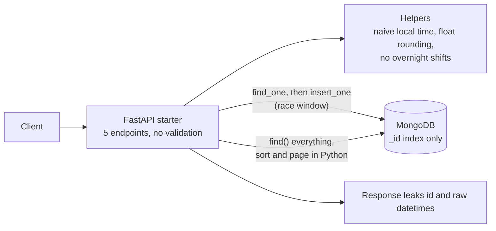
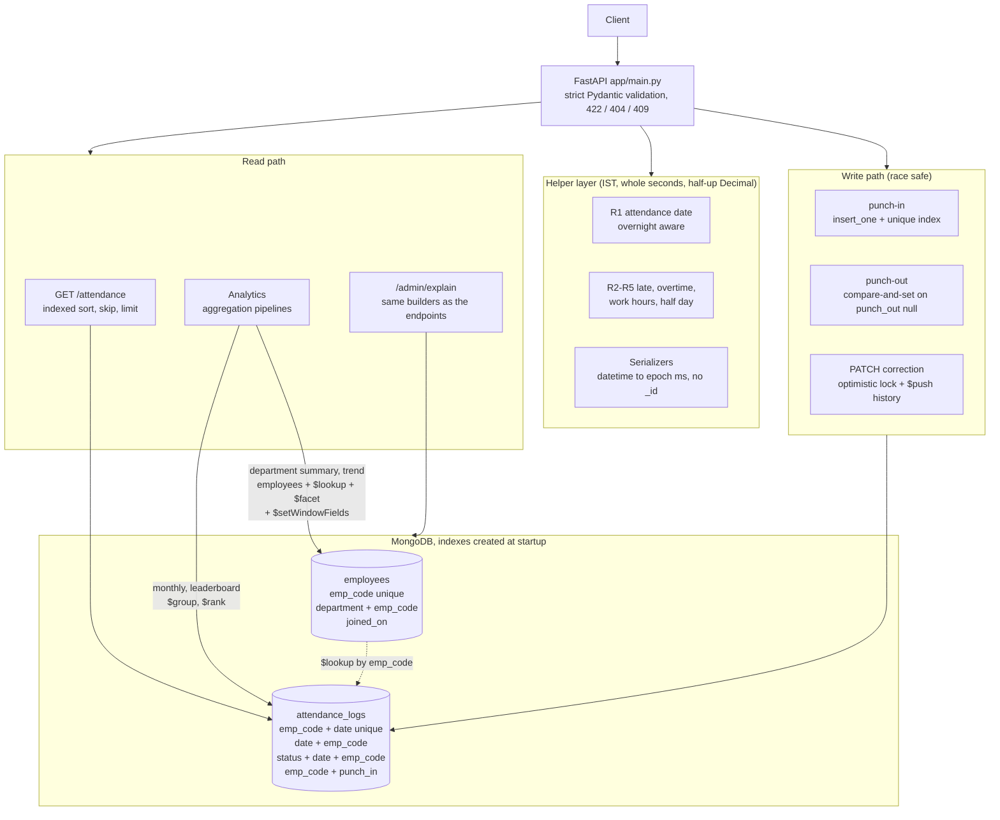

# Employee Attendance & Analytics API

FastAPI + MongoDB. All application code is in `app/main.py`.

## Run
```bash
python -m venv .venv && source .venv/bin/activate      # Windows: .venv\Scripts\activate
pip install -r requirements.txt
export MONGO_URI="mongodb://localhost:27017" MONGO_DB="attendance_db"   # or put them in a local .env
python sample_seed.py                                  # optional: loads the nine sample documents
uvicorn app.main:app --port 8000
```
Real environment variables win over `.env`. Indexes are created at startup (idempotent); `/health` is 200 once MongoDB answers.

## Tests
`pip install pytest httpx && python -m pytest tests -q` (needs a local MongoDB; uses the throw-away database `attendance_test`).
The tests cover R1-R5, the validation and status codes, concurrency (punch-in, punch-out, create, regularize) and compare
the analytics against a pure-Python reference on randomized data. `tests/` is not needed to run the app.

## Status
Everything in the contract is implemented: Part A fixes (see `REVIEW.md`), all endpoints, the three analytics aggregations,
the trend and the explain endpoint. Checked against 100k attendance records: every explain plan shows `IXSCAN` and no `COLLSCAN`.

## Architecture: before and after

### Before (the starter)
Five endpoints, no indexes, and the logic that mattered (dates, rules, uniqueness) lived in Python with check-then-insert.



### After (this submission)
All endpoints are implemented. Rules live in one helper layer, uniqueness and concurrency are decided by MongoDB, and every query is backed by an index.



| Area | Before | After |
|---|---|---|
| Time handling | Naive, machine-local time | Aware UTC in storage, IST for dates and shifts, epoch ms in the API |
| Uniqueness and races | Check, then insert | Unique indexes plus atomic insert and update |
| Listing | Load all, sort in Python | Indexed sort, skip and limit in MongoDB |
| Analytics | Not present | Aggregation pipelines over stored derived values |
| Proof | None | `/admin/explain/*`, `IXSCAN` and no `COLLSCAN` at 100k records |

## Interpretation choices worth knowing
* Punch-out closes the latest record with `punch_in <= punched_at`; if there is none (including a `punched_at` before every
  punch-in) the answer is 404, as the contract describes. `punched_at == punch_in` and more than 24 h later are 422.
* Trend range limit: at most 92 calendar days counting both ends. `moving_avg_7d` averages the unrounded daily rates and
  rounds the result half-up; the rates shown in the rows are rounded the same way.
* Analytics sum the stored `work_hours`, `late_minutes`, `overtime_minutes` and `half_day`; nothing is recomputed from punch times.
* A regularization that loses an optimistic-concurrency race is retried (re-read and recomputed) up to 5 times, then 409.
